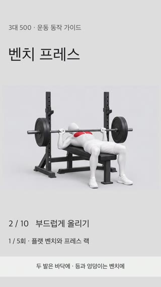
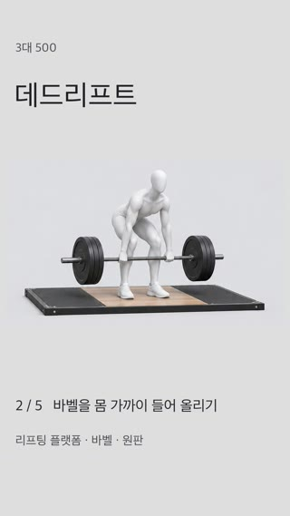
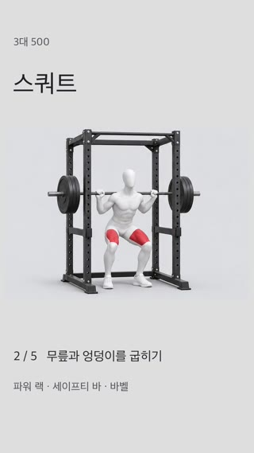
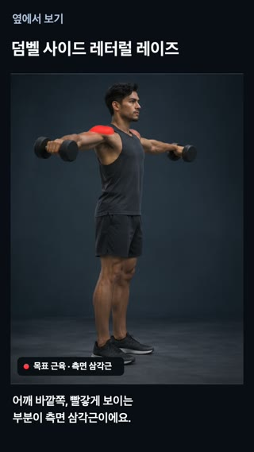

# 캡스톤 일지 · 운동 코칭 숏츠 제작

- 팀명: 유빈이 세상을 구한다
- 작성자: 채준혁
- 작업 기간: 2026.11.25~2026.11.26 (11월 25일 일지의 후속 작업 포함)
- 원본 일지: [2026.11.25 캡스톤 일지](./2026_11_25)

## 일주일 동안 내가 만들어 낸 것
캡스톤의 운동 코칭 콘텐츠를 보완하기 위해 세로형 운동 안내 영상을 제작했다.
사이드 레터럴 레이즈로 카메라 구도와 근육 강조 방식을 시험한 뒤, 벤치 프레스·데드리프트·스쿼트로 확장했다. 
첨부한 영상은 각 종목의 대표 버전이다.

| 종목 | 미리보기 | 영상과 구현 범위 |
| --- | --- | --- |
| 벤치 프레스 |  | [MP4](./assets/2026_11_26/bench_press.mp4) · 26초. 바벨을 3초 동안 내리고 2.2초 동안 올리는 구성을 5회 반복한다. 중간 자세, 한국어 코칭 음성, 자세·안전 자막을 적용했다. |
| 데드리프트 |  | [MP4](./assets/2026_11_26/deadlift.mp4) · 10초. 리프팅 플랫폼과 바벨을 보여주며, 들어 올리고 내려놓는 한 번의 동작을 5단계로 나눴다. |
| 스쿼트 |  | [MP4](./assets/2026_11_26/squat.mp4) · 10초. 파워 랙과 세이프티 바가 보이는 구도에서 한 번의 동작을 5단계로 보여준다. |
| 사이드 레터럴 레이즈 |  | [MP4](./assets/2026_11_26/lateral_raise.mp4) · 약 23초. 네 각도에서 측면 삼각근을 강조하고, 짧은 마네킹 반복 시범과 한국어 음성·자막을 넣었다. |

## 일주일 동안 겪었던 힘든 점과 해결 방법
초기 합성 음성은 말투와 호흡이 어색하게 들렸다. 문장을 짧게 나누고 코치가 직접 말하는 표현으로 고친 뒤, ElevenLabs 한국어 음성으로 다시 생성하고 자막 타이밍을 맞췄다.

## 내가 잘한 것과 아쉬웠던 점
참고 이미지, 장비가 보이는 구도, 자세 컷, 코칭 대본, 음성, 자막을 단계별로 수정해 피드백을 반영했다.
벤치 프레스에는 준비 자세, 바벨을 잡는 법, 내리고 올리는 법, 가벼운 무게로 연습하는 팁까지 넣었다.

## 다음주까지 해올 것

벤치 프레스 코칭 영상과 같은 구성으로 데드리프트·스쿼트의 음성과 자막을 보완한다.
세 종목의 자세와 근육 강조 위치를 검토.
